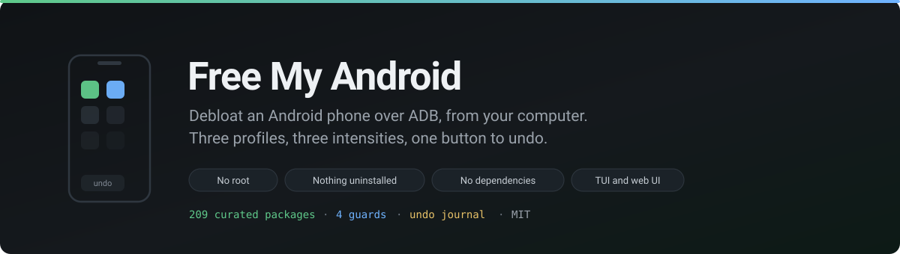
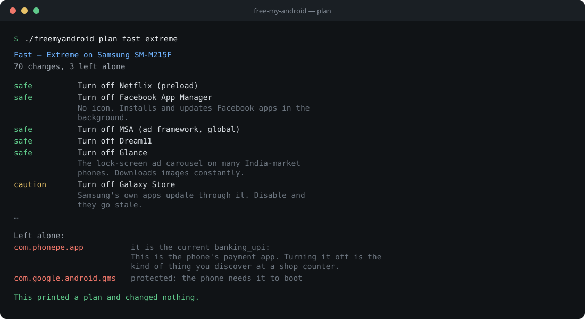
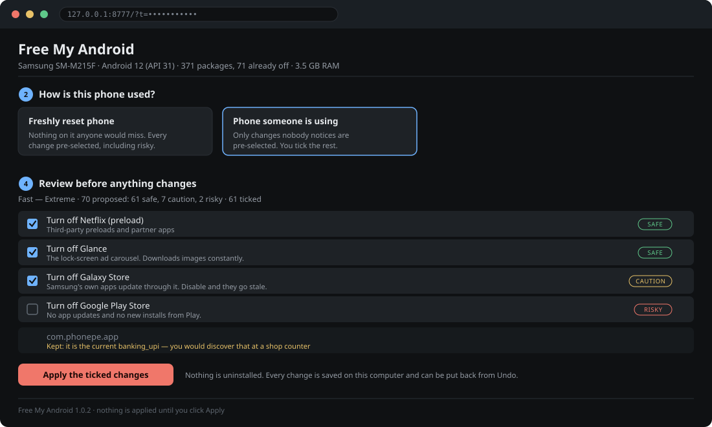

<div align="center">



<br>

[](CHANGELOG.md)
[](https://github.com/manishb27/freemyandroid/actions/workflows/check.yml)
[](https://www.python.org/downloads/)
[](#install)
[](LICENSE)

**Plug a phone in, or find it over Wi-Fi. Pick *Fast*, *Elder* or *Developer*.**<br>
Pick how far to go. Read exactly what will change, then apply it.

No root. Nothing uninstalled. Nothing installed on the phone unless you ask.

[Install](#install) · [Agents](#using-this-with-claude-or-another-agent) · [Web UI](#the-web-interface) · [Safety](#safety) · [Tested devices](docs/tested-devices/) · [Changelog](CHANGELOG.md) · [adb setup](docs/ADB.md) · [Phone as a server](docs/SERVER.md) · [Roadmap](docs/ROADMAP.md)

**Tested on a Samsung Galaxy M21** (Android 12): 71 packages disabled, 0
failures, ~110 MB of memory freed, nothing broken.
[Full before-and-after report →](docs/tested-devices/samsung-galaxy-m21.md)

</div>

## What it is

A tool that drives `adb` for you, with a terminal interface and a web one. It
knows **209 packages** across five curated lists, works out which of them are
on *your* phone, and refuses to touch the **57 packages and 16 vendor
prefixes** that would turn it into a brick.

<div align="center">

</div>

Three profiles, because "debloat my phone" means three different things:

| | What it does |
|---|---|
| **Fast** | Strip ads, analytics and paid-for preloads. The phone stays exactly as capable, with less running behind your back. |
| **Elder** | Keep a handful of large, obvious things — calls, messages, camera, photos, WhatsApp — and get everything else out of the way. Bigger text, longer screen timeout, slower long-press. |
| **Developer / server** | Keep every capability. Then switch off the things Android does to stop long-running background work, so the phone can actually hold a service up. |

Each one runs at three intensities. They are not vague adjectives; they are a
risk ceiling:

- **Standard** — only what nobody misses. Nothing you can see disappears.
- **Extreme** — also the OEM stores, themes, games hubs, assistants, cloud services. You will notice; nothing breaks.
- **Ultra** — the apps you have replacements for. Asks twice, and makes you type `apply`.

## Install

```sh
git clone https://github.com/manishb27/freemyandroid
cd freemyandroid
./freemyandroid          # terminal interface
./freemyandroid web      # or do it in a browser
```

That is the whole install. It is Python 3.10+ and the standard library — no
`pip`, no virtualenv, no build step. You need `adb`:

```sh
sudo apt install adb          # Debian, Ubuntu
sudo dnf install android-tools # Fedora
sudo pacman -S android-tools   # Arch
brew install android-platform-tools  # macOS
```

## Connecting a phone

**Over USB.** Settings → About phone → tap *Build number* seven times →
Developer options → *USB debugging*. Plug it in and tap *Allow*.

**Over Wi-Fi** (Android 11+). Developer options → *Wireless debugging* → on.
Then in the tool: *Pair with a code*, then *Find a phone on this network*.

Two things about wireless ADB that cost everyone an afternoon:

- The pairing port and the connect port are **different**. The number under
  *Pair device with pairing code* is not the one on the main screen.
- Android **stops advertising when the screen sleeps**. Keep the Wireless
  debugging screen open while you connect.

Discovery here does not use `adb mdns services`, because Debian and Ubuntu
ship `adb` with mDNS compiled out and that command then silently finds
nothing. It speaks DNS-SD directly, and falls back to a unicast sweep of your
subnet when the access point drops multicast between wireless clients — which
a lot of home routers do.

## The web interface

```sh
./freemyandroid web
#   http://127.0.0.1:8777/?t=<token>
```

<div align="center">

</div>

The terminal interface assumes whoever is driving it is also whoever decides.
That breaks in the two situations this actually gets used in: an assistant
doing the work while the phone's owner approves it, and someone debloating a
phone for a relative who wants to see what is being taken away.

So the web page is a **decision maker and a progress view**. It lists what is
proposed with the reason and the risk for each line, the owner ticks what they
are comfortable with, and then watches it apply line by line. Nothing reaches
a phone until someone clicks Apply.

It asks one question the tool cannot answer for itself:

- **Freshly reset phone** — nothing on it anyone would miss, so every change
  is pre-ticked including the aggressive ones.
- **Phone someone is using** — their photos and accounts are on it, so only
  the changes nobody notices are pre-ticked. Anything that removes a feature
  is left for a human to tick deliberately.

Bound to `127.0.0.1` and gated on a random per-run token that is printed with
the URL, because a page that can disable apps on a phone is not something to
expose by accident. `--lan` will bind everything, and says so loudly on
startup.

## Using this with Claude or another agent

This was built to be driven by an assistant, because "which of these 371
packages is safe to remove" is exactly the kind of question people want help
with. [AGENTS.md](AGENTS.md) is the full guide and most coding agents read it
automatically; [CLAUDE.md](CLAUDE.md) is the deeper one for changing the code.

### Getting started

Clone the repo, open your agent in the folder, and say something like:

```
I want to debloat my Android phone. This is a phone I own.
Read AGENTS.md first, then walk me through it.

My phone is a <make and model> running Android <version>.
Developer options and USB debugging are on, and it is plugged in.
```

The agent should then: check `./freemyandroid --version`, run
`./freemyandroid devices`, show you `./freemyandroid plan fast standard`
output, and **not change anything** until you have read it.

### Ask for the web interface

If you would rather click than read a terminal, say so:

```
Start the web interface and give me the link. I want to pick what gets
removed myself.
```

The agent runs `./freemyandroid web` in the background, reads the URL out of
its output, and hands it to you. You tick what you want and watch progress
stream line by line. **This is the recommended way** — the terminal interface
is curses and cannot be driven from a script, so an agent working through a
shell should always use the web one.

### Other things worth asking for

```
What is draining my battery?                        -> ./freemyandroid battery
Install a lighter home screen and make it default   -> the app catalogue
Undo everything you did today                       -> the journal
Set this phone up as a little server                -> see docs/SERVER.md
My phone is on Wi-Fi, not USB                       -> pairing walkthrough
I do not have adb installed                         -> ./freemyandroid adb get
```

### What the agent should never do

If an assistant does any of these, stop it:

- **Run `pm uninstall`.** This tool only ever disables. Uninstalling a system
  app without root means `--user 0` removal, which a factory reset is the
  usual way back from.
- **Work around a guard.** If something is refused, the refusal is the
  feature. The reason is printed; read it.
- **Apply a plan you have not seen.** Every subcommand except the two
  interfaces is read-only, so there is no reason to skip the review.
- **Pick "freshly reset phone" for a phone you are using.** That pre-selects
  the aggressive changes.

### Why it is shaped for this

- Everything on the command line **prints and changes nothing**, so an agent
  can explore freely without consequences.
- Applying requires a human click in one of the two interfaces.
- Every change is journalled with its exact inverse, so an agent that gets
  carried away is one Undo away from harmless.
- Errors say what to do next rather than what went wrong, because the person
  reading them is usually not the person who typed the command.

## Safety

The honest version: this disables packages on a phone you presumably rely on.
Here is every guard, and they all apply at every intensity, Ultra included.

1. **`pm disable-user`, never `pm uninstall`.** The APK stays on disk. `pm enable` brings it straight back.
2. **A hard guard list.** 57 packages and 11 vendor prefixes are never disabled by any profile at any intensity — `com.android.systemui`, the telephony stack, `com.google.android.gms`, Qualcomm and MediaTek components.
3. **Role occupancy.** The app currently answering calls, sending texts, drawing the home screen or typing is not disabled unless something else can take over. 19 roles, resolved against what is really installed.
4. **Accessibility.** A screen reader is never turned off automatically.
5. **Already-off packages are left alone**, so undo never re-enables something you chose to disable yourself.
6. **Every change is written down**, including a half-finished run, with the exact previous value of each setting.

```
Undo  →  pick a run  →  everything goes back
```

The journal lives in `~/.local/share/freemyandroid/journal/<serial>.json`.
Settings return to the value they actually had, not to a guessed default.

**What this cannot protect you from.** An OEM build that hides a Settings page
inside an app we think is junk. A package nobody has catalogued, picked by hand
in the Advanced screen — that one asks twice and tells you it is uncatalogued.
And a phone where a factory reset is not an option you can live with: take a
backup first.

## What is draining the battery

A curated list can tell you what a package *is*. It cannot tell you that on
your phone a weather widget has held a wake lock for four hours. So this reads
the phone's own accounting — `batterystats`, the alarm stats, the job
scheduler, the doze whitelist — ranks what it finds, and cross-references the
curated lists so you can see which of the offenders are also safe to remove.

```
   score  verdict   app                      why
    47.2  safe      Glance                   112 mAh, awake 38 min, 410 alarms, exempt from doze
     8.1  caution   HeyTap Push              24 wakeups, exempt from doze
```

`dumpsys` output is not a stable interface and differs by OEM and Android
version. Each reader returns nothing rather than guessing, and the report says
which readers produced data — so a thin report looks thin instead of being
quietly wrong.

## Apps and launchers

Elder mode is not much use if the person is left staring at the same OEM
launcher, and turning off Chrome is unkind if nothing else opens a link. So
the tool can fetch and sideload 32 open-source apps: launchers, dialers,
keyboards, browsers, galleries, and the Termux pieces the server profile needs.

Memory figures in the catalogue are **measured**, not claimed — PSS read off a
real phone after launching each one. They are worth measuring, because the
guesses are wrong:

| Launcher | Measured PSS |
|---|---|
| KISS | 24 MB |
| YAM Launcher | 20 MB |
| Olauncher | 47 MB |
| Neo Launcher (Nova-like) | 61 MB |
| µLauncher | 71 MB |
| Lawnchair 15 beta (Nova-like) | 78 MB |
| Samsung One UI Home | 111 MB |
| **Fossify Launcher** | **159 MB** |

Fossify Launcher has a 5 MB APK and is heavier at runtime than Samsung's own
launcher. µLauncher's APK is 4 MB and it uses three times KISS's memory.
Replacing a stock launcher is usually a big win, but only if you check.

**How these were measured, and the caveat.** Each was launched and its
`dumpsys meminfo` total PSS read. The stock launcher was measured while it
*was* Home; the others were not, and a launcher holding Home does more work —
wallpaper, widgets, staying resident. Neo Launcher measured 61 MB as an app
and 81 MB once it was actually the home screen. So treat these as a ranking
rather than a budget, and expect roughly 20 MB more from whichever one you
end up using.

Only two sources are allowed, and that restriction is the entire security
model: **the official F-Droid repo**, and **a project's own GitHub releases**.
No mirrors, no APK-download sites. Those are where repackaged binaries come
from, and plenty of ISPs sinkhole them anyway, so a download that "works" from
one of those is worse than one that fails.

Every download is SHA-256'd and recorded. `verify_signature()` will use
`apksigner` if you happen to have the Android build-tools; it does not pretend
to when you do not.

If your network blocks the hosts, build the bundle somewhere that works:

```sh
./freemyandroid bundle ~/apks termux termux-boot tailscale
```

## The phone as a server

The `dev` profile's real work is not debloating. It is this:

```
global/settings_enable_monitor_phantom_procs = false
```

Android 12 added a watchdog that kills an app's child processes once it has
too many. It is the reason Termux servers die after a few minutes with no
error in any log. Together with a doze exemption and *stay awake while
charging*, that is the difference between a phone that serves something and a
phone that used to.

**Real Docker cannot run on an unrooted phone.** `dockerd` needs kernel
namespaces, cgroups and overlayfs, and Android grants an app none of the
three. Rooting helps less than people expect. Four things do work, and
[`docs/SERVER.md`](docs/SERVER.md) covers all four — Termux + proot-distro,
udocker, the Android 16 Linux Terminal VM, and QEMU — with what each one
costs.

## Command line

The interface does everything. These exist for scripting and for SSH sessions
where curses is awkward. **None of them change a phone.**

```sh
./freemyandroid devices                 # what is connected
./freemyandroid scan                    # find phones on this network
./freemyandroid info                    # what kind of phone it is
./freemyandroid plan fast extreme       # print the plan, change nothing
./freemyandroid battery                 # what is costing power
./freemyandroid apps                    # the catalogue
./freemyandroid bundle ~/apks           # pre-download APKs
./freemyandroid undo                    # list recorded runs
```

## Adding to the lists

`data/packages/*.json`. One entry per package:

```json
{"id": "com.miui.msa.global", "label": "MSA (ad framework)",
 "risk": "safe", "tags": ["ads"],
 "note": "The system ad service. Puts ads in Settings and the file manager."}
```

`risk` is `safe`, `caution` or `risky`, and it is the intensity ceiling, so
getting it right is the whole job. `note` is what breaks — write it for
someone who will read it at the moment they are deciding. Pull requests with a
package name and no note are the ones that go wrong.

`applies_to` matches against the vendor key resolved from
`ro.product.manufacturer` and `ro.product.brand`; `["*"]` means every phone.

## Status

**1.0.2.** The engine, the guards, the journal, discovery, the battery report,
the catalogue, default-app switching and both interfaces work and have been
exercised end to end against real hardware.

| Device | Android | What was done | Report |
|---|---|---|---|
| Samsung Galaxy M21 (SM-M215F) | 12 (API 31) | `fast/extreme` applied, launcher swapped, 71 packages off, 0 failures | [report](docs/tested-devices/samsung-galaxy-m21.md) |

That one device found **eight bugs**, every one by being run rather than by
anyone reading the code — including a guard that could never have fired, a
regex that silently discarded every power figure while still reporting
success, and a catalogue entry that fetched a 2020 build. The report lists
them, because a project that only publishes its wins is not telling you much.

Not done yet, in order of how much it matters:

- **No test suite.** Everything above was verified by hand. This is the
  biggest gap in the repo.
- The web panel for running services on the phone is designed in
  `docs/SERVER.md`, not built.
- No vivo, Motorola or Transsion package lists.
- Windows is untested; `curses` is not in its standard library, so the TUI
  needs WSL there. The web interface works anywhere.

If you run it on something, a line in an issue saying what happened is
genuinely useful — especially if a guard fired when it should not have, or
did not when it should. `./freemyandroid --version` and the relevant journal
file are the two things worth attaching.

## Credit

[Universal Android Debloater Next Generation](https://github.com/Universal-Debloater-Alliance/universal-android-debloater-next-generation)
and [Canta](https://github.com/samolego/Canta) got here years earlier and are
both excellent. If you want a GUI on your desktop or an app on the phone
itself, use those. This exists for the terminal and the browser, for the three
profiles, and for the undo journal.

The package lists here were written for this project. Where a package's
behaviour was already common knowledge in the debloating community, those two
projects are the reason it is.

## Licence

MIT. See [LICENSE](LICENSE).
